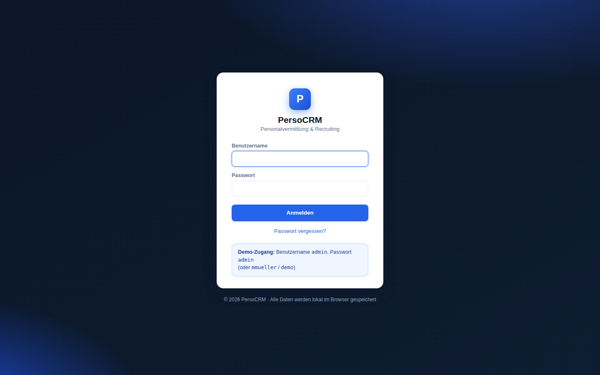
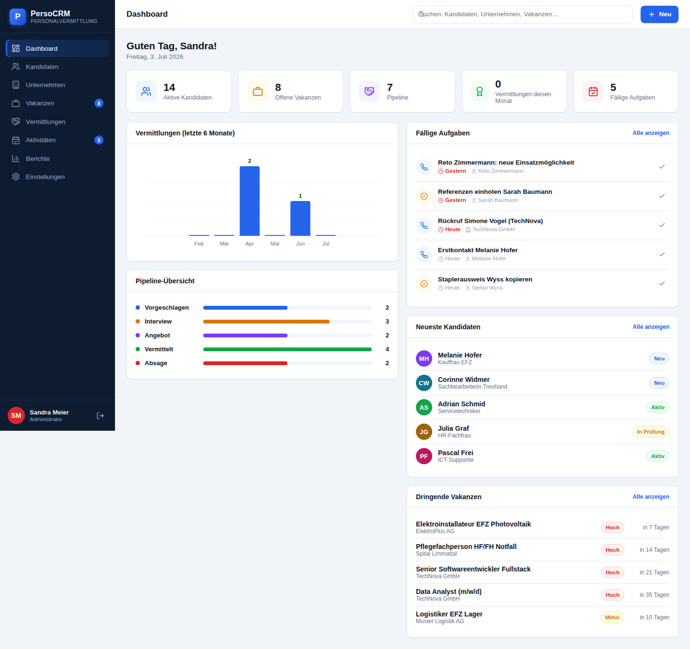
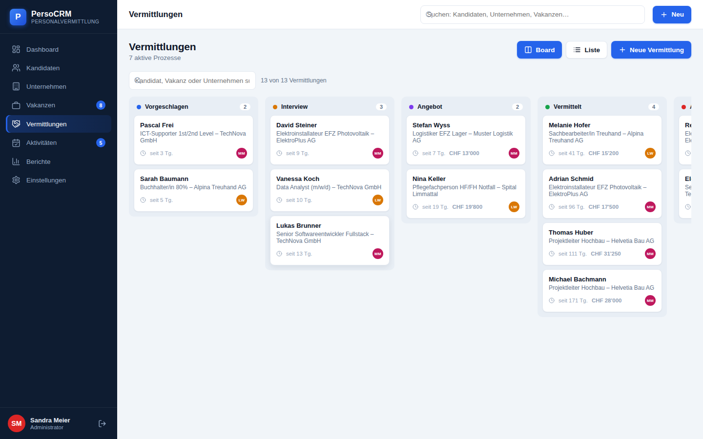
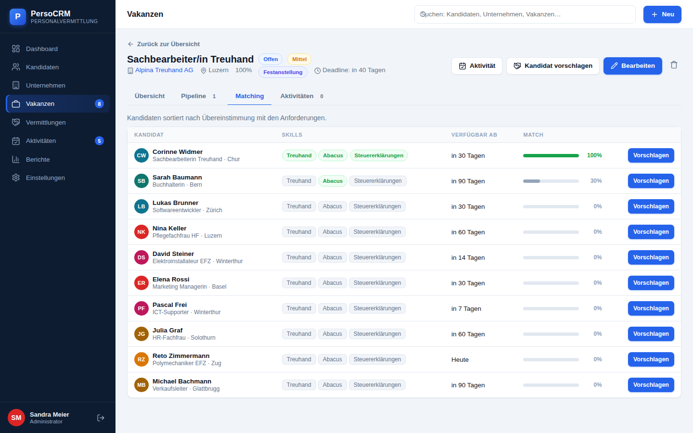
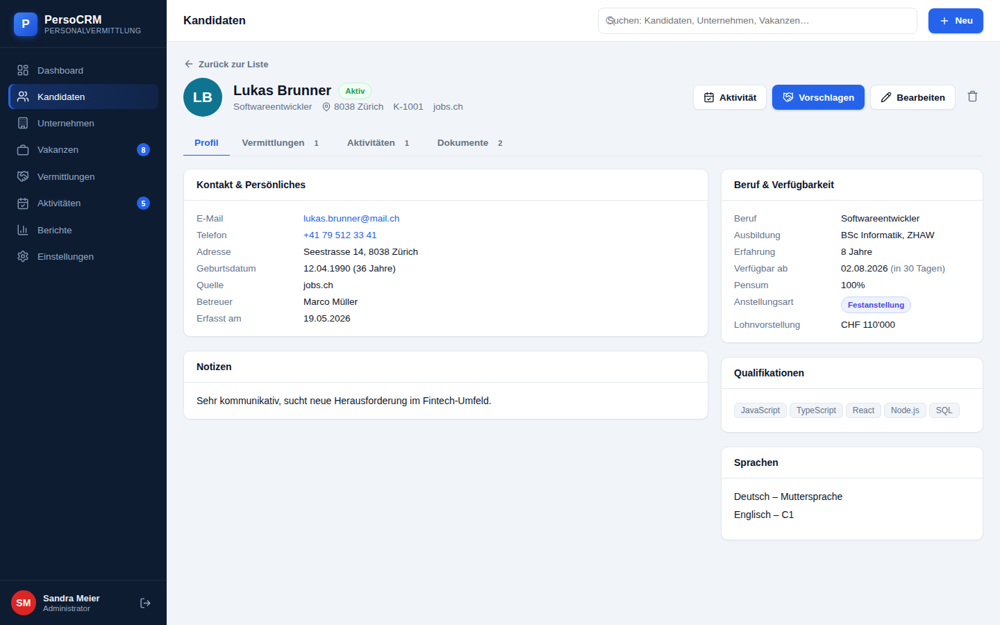
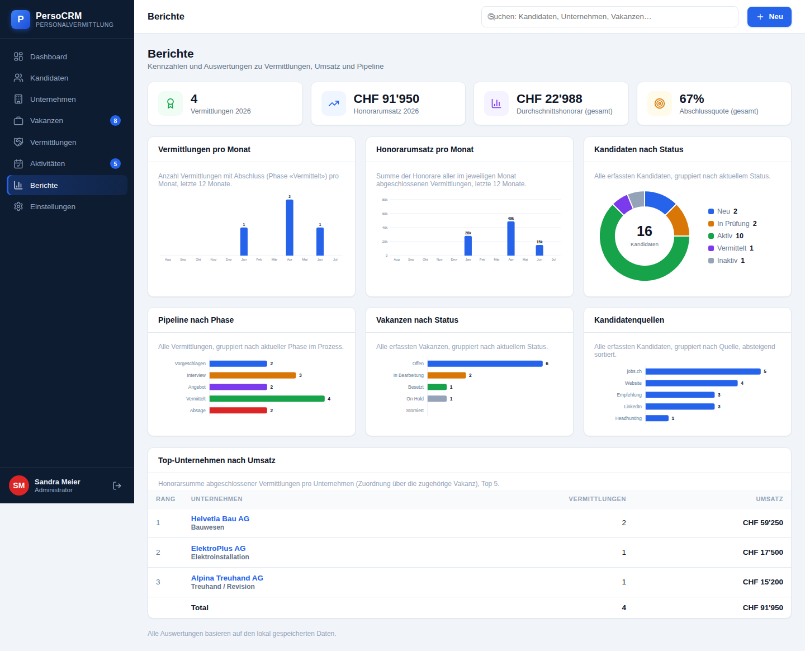

# PersoCRM – Personalvermittlungs-CRM

Ein vollständiges, deutschsprachiges CRM-System für Personalvermittlung und Recruiting –
inspiriert von branchenüblichen Personaldienstleister-Lösungen (Login-Maske, Hash-Routing `#/`,
Dashboard, Kandidaten- und Kundenverwaltung, Vakanzen, Vermittlungs-Pipeline, Auswertungen).

| | |
|---|---|
|  |  |
|  |  |
|  |  |

## Funktionen

| Modul | Beschreibung |
|---|---|
| **Login** | Anmeldemaske nach Vorbild (Benutzername, Passwort, «Passwort vergessen?») |
| **Dashboard** | KPIs, Vermittlungs-Chart, Pipeline-Übersicht, fällige Aufgaben, neueste Kandidaten, dringende Vakanzen |
| **Kandidaten** | Liste mit Suche/Filter/Sortierung, Detaildossier mit Tabs (Profil, Vermittlungen, Aktivitäten, Dokumente), Erfassen/Bearbeiten |
| **Unternehmen** | Kundenfirmen mit Ansprechpartner-Verwaltung, Vakanzen-Übersicht, Umsatzstatistik |
| **Vakanzen** | Stellenaufträge mit Lohnband, Anforderungen, Deadline, Pipeline pro Stelle und **Kandidaten-Matching** (Skill-Score) |
| **Vermittlungen** | Kanban-Board mit Drag & Drop über die Phasen Vorgeschlagen → Interview → Angebot → Vermittelt / Absage, inkl. Verlaufshistorie |
| **Aktivitäten** | Aufgaben, Anrufe, Termine, E-Mails, Notizen – gruppiert nach Fälligkeit (überfällig/heute/…) mit Bezug zu Kandidat/Firma/Vakanz |
| **Berichte** | Vermittlungen & Honorarumsatz pro Monat, Status-Verteilungen, Pipeline-Funnel, Kandidatenquellen, Top-Unternehmen |
| **Einstellungen** | Profil, Benutzerverwaltung (Admin), Firmendaten, JSON-Export/-Import, Demo-Reset |

Weitere Querschnittsfunktionen: globale Suche (Kandidaten/Firmen/Vakanzen), Schnellerfassung
(«+ Neu»), Navigations-Badges für offene Vakanzen und fällige Aufgaben, responsives Layout.

## Schnellstart

Die Anwendung ist eine reine Client-Anwendung (Single-Page-App) **ohne Build-Schritt und ohne
Abhängigkeiten**. Alle Daten werden lokal im Browser gespeichert (`localStorage`).

```bash
# Variante 1: beliebiger statischer Webserver
python3 -m http.server 8080
# dann http://localhost:8080/index.html#/ öffnen

# Variante 2: PHP (analog zum Vorbild index.php#/)
php -S localhost:8080
# dann http://localhost:8080/index.php#/ öffnen
```

Oder `index.html` direkt im Browser öffnen.

### Demo-Zugänge

| Benutzername | Passwort | Rolle |
|---|---|---|
| `admin` | `admin` | Administrator |
| `mmueller` | `demo` | Berater |
| `lweber` | `demo` | Beraterin |

Beim ersten Start werden realistische Demo-Daten geladen (16 Kandidaten, 8 Unternehmen,
10 Vakanzen, 13 Vermittlungen, 22 Aktivitäten). Unter **Einstellungen → Daten** lassen sich die
Demo-Daten jederzeit zurücksetzen oder als JSON exportieren/importieren.

## Technik

- **Frontend:** Vanilla JavaScript (ES2020), kein Framework, keine externen Bibliotheken
- **Routing:** Hash-Router (`#/kandidaten/101`) mit Login-Guard
- **Persistenz:** `localStorage` (Sammlung `persocrm_data_v1`), Demo-Seed mit relativen Datumsangaben
- **Diagramme:** pures Inline-SVG (validierte, farbfehlsichtigkeits-sichere Palette)
- **Design:** eigenes Design-System in `css/app.css` (Sidebar-Navigation, Karten, Tabellen, Badges, Kanban, Modals, Toasts)

```
├── index.html            # App-Shell (Script-Ladereihenfolge)
├── index.php             # PHP-Wrapper (optional, analog zum Vorbild)
├── css/app.css           # Design-System
└── js/
    ├── app.js            # Shell: Sidebar, Topbar, globale Suche, «+ Neu»
    ├── core/
    │   ├── store.js      # Datenhaltung (localStorage, CRUD, Nummernkreise)
    │   ├── auth.js       # Anmeldung/Session
    │   ├── router.js     # Hash-Router & View-Registry
    │   ├── ui.js         # UI-Bibliothek (Icons, Modals, Toasts, Badges, Formate)
    │   └── shared.js     # Geschäftskomponenten (Aktivitäten, Vermittlungen, Matching)
    ├── data/seed.js      # Demo-Daten
    └── views/            # Ein Modul pro Ansicht
        ├── login.js  dashboard.js  kandidaten.js  unternehmen.js
        ├── vakanzen.js  vermittlungen.js  aktivitaeten.js
        ├── berichte.js  einstellungen.js
```

## Hinweise

- Dies ist eine **Demo-/Ausgangsbasis**: Authentifizierung und Datenhaltung sind bewusst
  clientseitig gehalten. Für den Produktivbetrieb gehören Login, Berechtigungen und Daten auf
  einen Server (z. B. REST-API + Datenbank); die View-Schicht kann unverändert weiterverwendet
  werden, indem `js/core/store.js` gegen eine API-Anbindung getauscht wird.
- Schweizer Schreibweise («ss» statt «ß»), Beträge in CHF, Datumsformat TT.MM.JJJJ.
