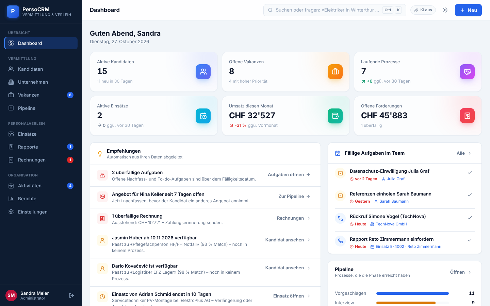
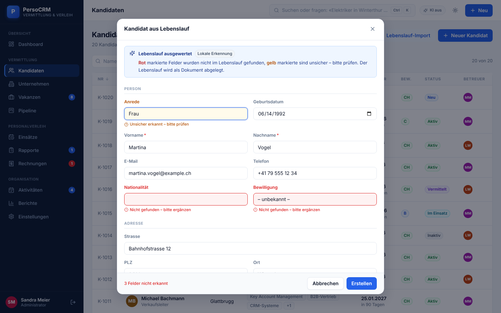
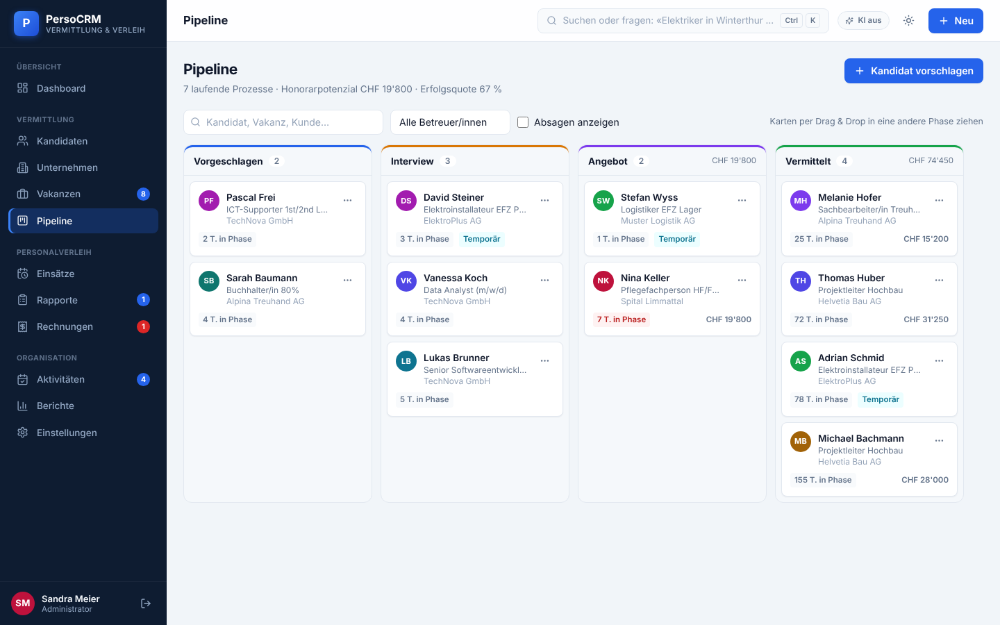
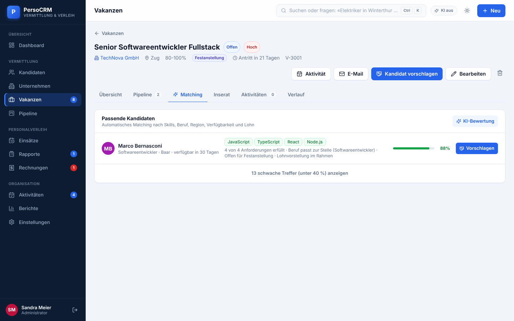
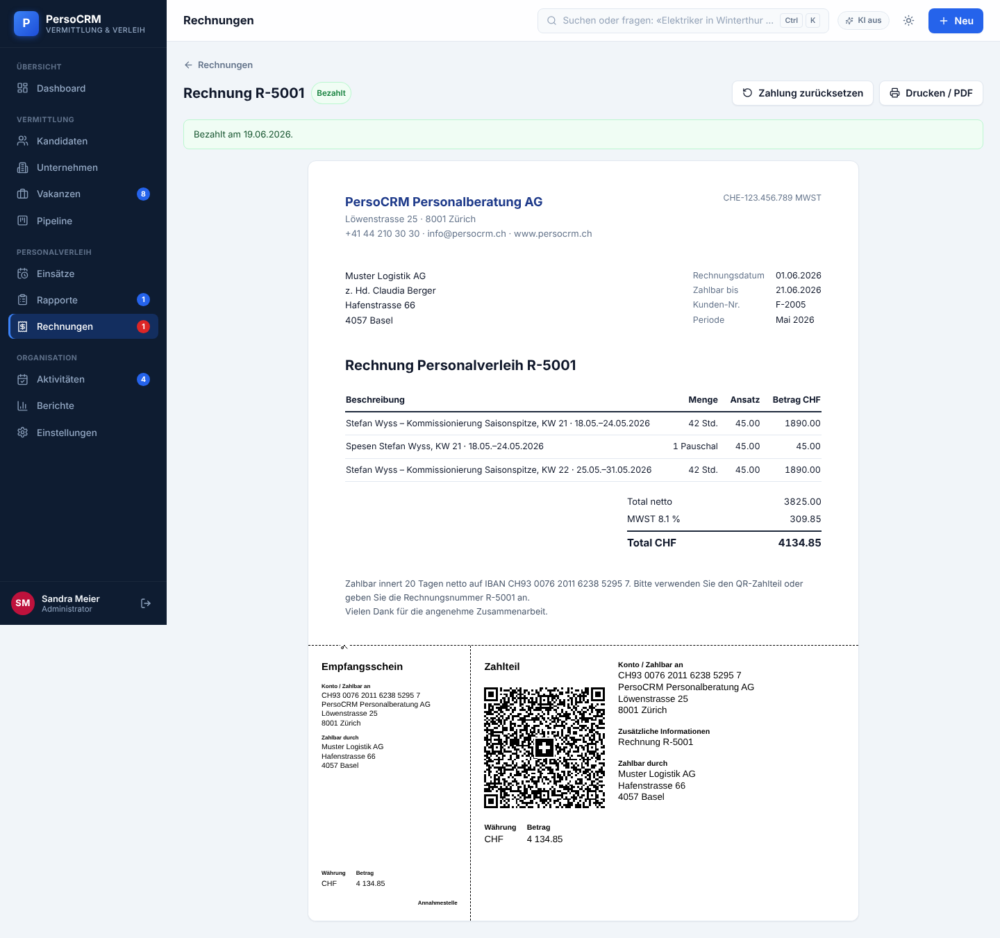
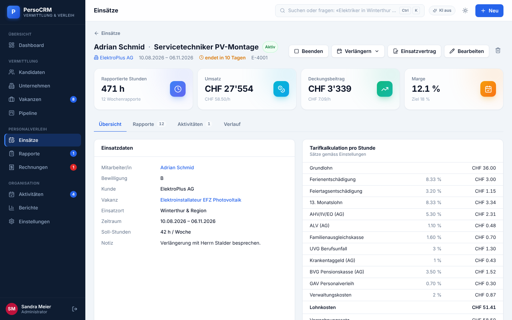
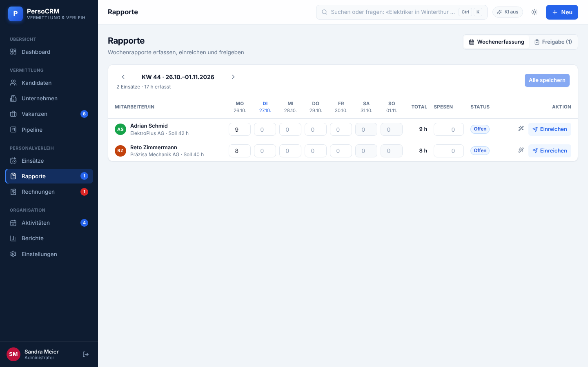
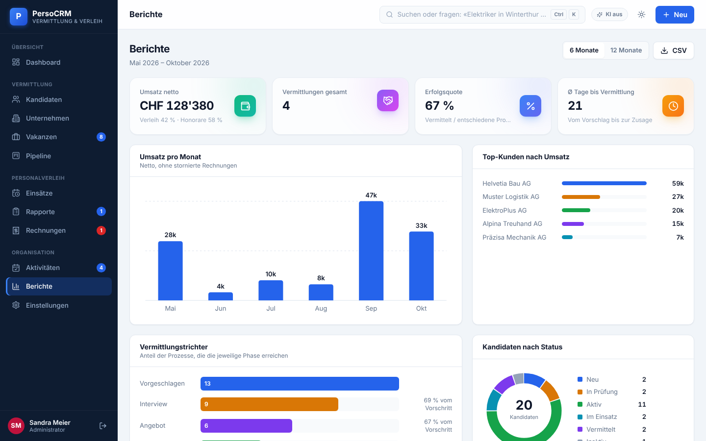
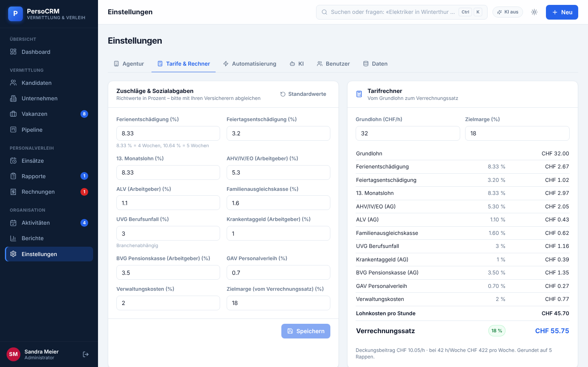
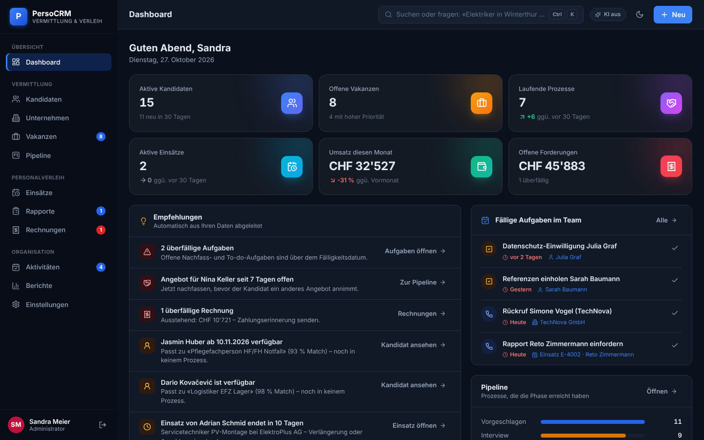

# PersoCRM 2 – CRM für Personalvermittlung & Personalverleih

PersoCRM ist ein deutschsprachiges CRM für Schweizer Personaldienstleister. Es deckt beide
Geschäftsfelder ab:

- **Feste Vermittlung:** Kandidaten → Vakanzen → Pipeline → Honorarrechnung
- **Temporärer Personalverleih:** Einsatz → Wochenrapporte → Freigabe → Rechnung mit QR-Zahlteil

Viele Routinearbeiten übernimmt das System selbst: Lebensläufe einlesen, Firmendaten von
Webseiten holen, passende Kandidaten finden, Texte schreiben und ans Nachfassen erinnern.

**Live:** https://crm-rho-seven-72.vercel.app · Demo-Login `admin` / `admin`

| | |
|---|---|
|  |  |
|  |  |
|  |  |
|  |  |
|  |  |

## Automatisierung & KI

| Funktion | Was passiert |
|---|---|
| **Lebenslauf-Import** | PDF, Word (.docx), Foto/Scan oder Text hochladen → das Kandidatenformular wird ausgefüllt. **Felder, die im Lebenslauf fehlen, sind rot markiert**, unsichere gelb. Dazu kommen Duplikatwarnung (E-Mail/Name) und Ablage als Dokument mit Volltext. |
| **Webseiten-Import** | Firmen-URL eingeben → Startseite plus Kontakt-/Impressumsseiten werden gelesen: Name, Adresse, Telefon, E-Mails, Branche, LinkedIn und Ansprechpersonen (mit Auswahlliste). Fehlende Felder sind rot markiert. |
| **Suche in Alltagssprache** | `Ctrl+K` → «Elektriker in Winterthur ab sofort mit B-Bewilligung» wird zu Filtern (Beruf, Ort, Verfügbarkeit, Bewilligung, Erfahrung) und lässt sich als Link teilen. |
| **Matching** | Jede Vakanz zeigt passende Kandidaten nach Skills, Beruf, Region, Verfügbarkeit und Lohn. Die **KI-Bewertung** ergänzt eine Begründung mit Stärken und Lücken. |
| **Texte** | Anonymisiertes Kurzprofil, Stelleninserat sowie E-Mails (Vorstellung beim Kunden, Interview-Einladung, Absage, Nachfassen, Angebot) per Knopfdruck. |
| **Empfehlungen** | Das Dashboard meldet: überfällige Aufgaben, Vakanzen ohne Kandidaten, frei werdende Kandidaten mit passender Vakanz, liegengebliebene Angebote, endende Einsätze, fehlende oder freizugebende Rapporte und überfällige Rechnungen. Jede Meldung führt direkt zur passenden Seite. |
| **Folgeaktionen** | Nachfass-Aufgabe bei jedem Phasenwechsel. Der Kandidatenstatus «Im Einsatz»/«Vermittelt» und der Vakanzstatus «Besetzt» werden automatisch gesetzt. Rapporte werden nach Kunde und Monat gruppiert und mit einem Klick verrechnet. |

**Ohne KI-Schlüssel** läuft alles mit eingebauter lokaler Erkennung (Heuristiken), auch offline.
**Mit KI** (Claude über die Serverfunktion `api/ai.ts`) wird die Auswertung deutlich genauer, liest
auch Scans und Fotos und erkennt Ansprechpersonen. Jedes Ergebnis zeigt, ob es von der KI oder aus
der lokalen Erkennung stammt. Schlägt die KI fehl, nutzt die App automatisch die lokale Erkennung.

## Personalverleih (Schweiz)

- **Tarifrechner:** Grundlohn → Ferien (8.33 %), Feiertage, 13. ML → AHV/ALV/FAK/UVG/KTG/BVG/GAV →
  Lohnkosten → Verrechnungssatz bei Zielmarge, auf 5 Rappen gerundet. Alle Sätze sind einstellbar.
- **Einsätze** mit Live-Marge (Ampel), Deckungsbeitrag, «Verlängern» (+1 Woche/+4 Wochen/+3 Monate)
  und druckbarem **Einsatzvertrag** (AVG Art. 19).
- **Wochenrapporte:** Erfassung im Wochenraster, Soll-Stunden per Klick übernehmen, einreichen,
  freigeben. Eigene Freigabe-Ansicht mit «Alle freigeben».
- **Rechnungen:** Verleih (aus Rapporten) und Vermittlungshonorar, MWST 8.1 %, 5-Rappen-Rundung,
  **Swiss QR-Rechnung** (Zahlteil mit Empfangsschein, UTF-8-QR-Code nach SIX-Vorgaben, IBAN-Prüfung),
  Stornierung (gibt Rapporte wieder frei), Zahlungserinnerung per E-Mail, CSV für die Buchhaltung.

## Weitere Funktionen

Kandidaten- und Firmendossiers mit Tabs · Kanban-Pipeline mit Drag & Drop · Aktivitäten
(überfällig/heute/Woche) mit **Kalender-Export (.ics)** · Berichte (Umsatz, Top-Kunden, Trichter,
Rekrutierungskanäle, Berater-Leistung) · Befehlspalette `Ctrl+K` · **Rückgängig** nach dem Löschen ·
Änderungsprotokoll · hell/dunkel/System · Mobilansicht · CSV-Exporte · JSON-Sicherung und -Import ·
Benutzer und Rollen (Administrator/Berater) · automatische Übernahme der Daten aus PersoCRM v1.

### Demo-Zugänge

| Benutzer | Passwort | Rolle |
|---|---|---|
| `admin` | `admin` | Administrator |
| `mmueller` | `demo` | Berater |
| `lweber` | `demo` | Beraterin |

Demodaten: 20 Kandidaten, 9 Unternehmen, 10 Vakanzen, 13 Vermittlungsprozesse, 4 Einsätze mit
Rapporten, Rechnungen und Aktivitäten. Datumswerte sind relativ zu heute, deshalb wirkt die Demo
immer aktuell. Zurücksetzen unter *Einstellungen → Daten*.

## Entwicklung

```bash
npm install
npm run dev        # http://localhost:5173 – inkl. /api/* (Vite-Plugin führt die Serverfunktionen aus)
npm test           # Unit-Tests der Fachlogik (Vitest)
npm run build      # Typprüfung (App + API) und Produktions-Build nach dist/
```

Für die KI lokal: `ANTHROPIC_API_KEY=sk-ant-… npm run dev`, oder den Schlüssel in der App unter
*Einstellungen → KI* hinterlegen.

### Deployment (Vercel)

Das Repository ist für Vercel konfiguriert (`vercel.json`: Vite-Build, SPA-Routing,
Serverfunktionen `api/ai.ts` und `api/scrape.ts`, Sicherheits-Header). Umgebungsvariablen:

| Variable | Zweck |
|---|---|
| `ANTHROPIC_API_KEY` | Server-Schlüssel für die KI (optional; ohne ihn arbeitet die App lokal oder mit eigenem Schlüssel im Browser) |
| `APP_ACCESS_TOKEN` | Optional: schützt die KI-Funktion. Das Token wird in der App unter *Einstellungen → KI* eingetragen |
| `ANTHROPIC_MODEL` | Optional: Standardmodell (Vorgabe `claude-opus-5-5`) |

`api/scrape.ts` lädt Webseiten serverseitig: nur http/https auf den Ports 80/443, DNS-Prüfung gegen
private und interne Adressen (SSRF-Schutz), geprüfte Weiterleitungen, Grössen- und Zeitlimits.

## Technik

React 18 · TypeScript (strict) · Vite · Tailwind CSS (Design-Tokens, Dark Mode) · Zustand (persistiert
in `localStorage`) · React Router (Lazy Loading je Seite) · framer-motion (Kennzahl-Karten) · lucide-react · pdf.js und mammoth
(nur bei Bedarf geladen) · qrcode-generator · Anthropic SDK (strukturierte Ausgaben) · Vitest ·
Diagramme als eigenes Inline-SVG.

```
api/                    Serverfunktionen (Vercel): ai.ts (KI-Aufgaben), scrape.ts (Webseiten)
src/
├── types.ts            Datenmodell und Wertelisten (einzige Quelle für Status-Werte)
├── domain/             Reine Fachlogik, getestet: Tarif, Abrechnung, QR-Rechnung, Matching,
│                       Suche, Lebenslauf-/Firmen-Erkennung, Empfehlungen, Kennzahlen, Vorlagen
├── data/               Demodaten und Migration aus v1
├── store/              Zustand-Store mit allen Schreibaktionen (inkl. Audit-Log und Folgestatus),
│                       Session, UI (Toasts, Dialoge, Theme), Selektoren
├── lib/                KI-Client mit Fallbacks, Datei-Extraktion, Hooks, Downloads
├── components/         UI-Bausteine, Diagramme, Layout, gemeinsame Fachkomponenten
└── features/           Eine Mappe je Bereich (Kandidaten, Unternehmen, Vakanzen, Pipeline,
                        Einsätze & Rapporte, Rechnungen, Aktivitäten, Dashboard, Berichte, Einstellungen)
```

Alle Schreibzugriffe laufen über die Aktionen in `src/store/data.ts`. Die Seiten enthalten keine
Geschäftsregeln. Was sich ohne Oberfläche prüfen lässt (Tarife, Rechnungsbeträge, QR-Nutzdaten,
Matching, Suche, Erkennung), liegt in `src/domain` und ist mit Unit-Tests abgedeckt.

## Hinweise

- Demo-Betrieb: Anmeldung und Daten liegen im Browser (`localStorage`). Für den produktiven
  Mehrbenutzerbetrieb gehören Authentifizierung und Datenhaltung auf einen Server. Dafür wird
  nur `src/store/data.ts` gegen eine API-Anbindung getauscht.
- Die Sätze für Sozialabgaben sind Richtwerte und müssen mit den eigenen Versicherern abgeglichen werden.
- Schweizer Schreibweise («ss»), Beträge in CHF, Datumsformat TT.MM.JJJJ.
